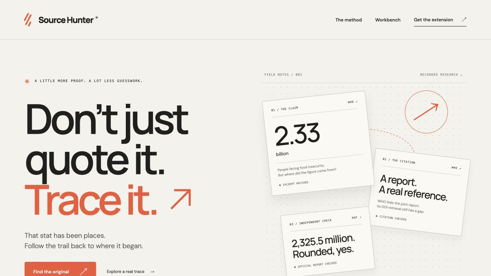

# Source Hunter

Check a claim before passing it on. Source Hunter pairs a Chrome extension with a local workbench to inspect the wording, dates, observed citation links and missing sources behind a highlighted line.

The saved preview contains five investigations from one genuine TinyResearch batch and nine TinyFish Fetch checks, followed by a separate source review. A later unseen NOAA test used one Deep run and ten Fetch checks in total. The original Chrome packet recorded nine checks after manual recovery; a separately authorized tenth check captured the proposed PDF and local review reached a producer briefing. Earliest origin remains unresolved.

**Form prepared; awaiting the owner's final Submit click.** Saved lookup needs no credentials or provider credits. The current five-case Chrome and workbench regressions, exports and pause controls passed. Promotion is published and read back, and the bounty was claimed on 10 November 2026. Authenticated form review passed. The owner's final submission click and portal readback remain open. Fresh research is paused.



This landing capture shows the current paused preview. The [124-second walkthrough](source-hunter/evidence/media/source-hunter-demo.mp4) combines real saved-case captures with the actual NOAA recovery. It is edited and silent, not a continuous live session. [Video evidence notes](docs/DEMO.md).

Source and recorded evidence are public in the [public GitHub repository](https://github.com/himanshu748/source-hunter). The [anonymous-clone verification](source-hunter/evidence/checks/public-clone-verification.json) passed at commit `c294c2a1d2461be188feb9c4ee25073a992bb0b3` on Node.js 22.14 without provider credentials or grants: clean install, 99 tests, typecheck, build, review reproduction, formatting and recorded-only HTTP checks passed. No provider requests were started. The application runs locally; this is not a hosted deployment.

## Try the saved investigations

Use Node.js 22 or newer. Clone the public repository and start the recorded preview:

```sh
git clone https://github.com/himanshu748/source-hunter.git
cd source-hunter
npm ci
BOUNTY_POOL_LIVE=0 npm start
```

Open <http://127.0.0.1:4388/> and explore a recorded claim. Switch among food security, DDoS mitigation, air quality, an Earth-year approximation and a historical Great Wall quotation. The food estimate has a supported rounding explanation. NASA contradicts the historical Moon-visibility assertion, while the selected article examines that myth skeptically. All five saved cases keep their earliest-origin gaps.

Read the [extension setup](source-hunter/README.md#use-the-chrome-extension), [judge guide](source-hunter/docs/JUDGE_GUIDE.md), [evidence guide](source-hunter/docs/EVIDENCE.md) and [privacy boundaries](source-hunter/docs/PRIVACY.md).

## Recorded evidence and fresh research

Saved lookup matches the selected text and public URL to an existing investigation. It never substitutes a related claim or starts research. TinyResearch proposes the trail; exact-page TinyFetch observations check wording and links. Application errors, navigation shells and failed retrievals cannot prove a quote absent.

The unseen NOAA test selected a statement about 2024 being the warmest year on record. Research completed, then changed wallet meters blocked Fetch pricing preflight before any Fetch request. After confirming the account's Hobby tier and daily quota, the operator clicked **Resume source checks** once. Nine checks reused the same completed Research receipt, with no second Research job or automatic retry. The full native export matched the private packet. [Fresh test receipt](source-hunter/evidence/fresh/fresh-verification.json).

The separately labelled [cached re-evaluation](source-hunter/evidence/fresh/noaa-local-re-evaluation.json) used zero new network requests to correct form-shell and contained-short-quote-reference findings. The [original nine-check Chrome export](source-hunter/evidence/fresh/noaa-original-export.json) stays unchanged. Its failed PDF request remains historical. Later, the user explicitly authorized one manual PDF repeat using the tenth remaining Fetch check, without more Research or a higher budget. The PDF was captured with HTML selectors omitted. Local review reached an official NOAA/NASA producer briefing supporting the 2024-warmest finding; underlying dataset validation, exact publication day, earliest authorship and the form-portal-to-PDF citation edge remain unproved. [Manual check](source-hunter/evidence/fresh/manual-pdf-check.json), [separate review](source-hunter/evidence/fresh/manual-pdf-review.json). The CSV branch still has mocked coverage only.

The current server preflights Fetch pricing before starting paid Research or consuming a recovery marker, then checks a fresh quote again before each Fetch. `TINYFISH_FETCH_PRICING_TIER=hobby` is an explicit operator binding used only after account-tier and quota confirmation. There is no cheapest-meter selection or Builder fallback.

## Verification and release boundary

```sh
npm test
npm run typecheck
npm run build
npm run review:check
npm run format:check
```

The final automated pass completed **99 tests**, TypeScript, build, review reproduction and formatting on Node.js 26.12. Earlier Chrome and desktop checks passed all five saved cases, WHO full Chrome export and Great Wall workbench export. After unlock, all five saved Chrome highlights/lookups/date-assessment displays and all five workbench cases passed again against the current controls. Great Wall workbench export, paused recovery, keyboard dialog and manual reduced motion also passed. The actual NOAA recovery popup and full native export are recorded separately.

Current dialog keyboard controls and manual reduced motion passed. The mobile viewport override was ignored, so mobile sizing and OS reduced-motion preference remain unverified. The 124-second H.264 walkthrough passed 1080p/60 fps metadata, full decoding and sampled-frame visual inspection. [Software receipt](source-hunter/evidence/verification-2026-11-09.json), [media receipt](source-hunter/evidence/media/video-verification.json).

The old $10 shared ledger remains unchanged and halted. A separate $2 supplement is fully reserved for the NOAA test, bringing the aggregate authorized ceiling across the bounty work to $12. These reservations are not a verified invoice. No further provider job, retry, purchase or billing change is authorized. HTTP and the native popup both confirmed that fresh research is paused. Recovery stayed disabled even with a valid investigation ID.

The package uses TypeScript, Node.js, Chrome Manifest V3, Zod, Cheerio, TinyResearch and TinyFetch. Fonts and scripts are local; font notices are under `ui/assets/`. No source license has been selected. Source and recorded evidence are in the [public GitHub repository](https://github.com/himanshu748/source-hunter). The application runs locally. No hosted service or bounty submission is established. Promotion is published and read back, and the bounty is claimed. See the [release gates](docs/RELEASE_GATES.md) and [submission draft](docs/SUBMISSION_DRAFT.md).

## Promotion and entry status

[LinkedIn](https://www.linkedin.com/feed/update/urn:li:activity:7525837908667404288/), [Discord showcase](https://discord.com/channels/1200506685236711554/1569631090870853713) and [X](https://x.com/jhahimanshu653/status/2120073889749635288) were published and read back on 10 November 2026. LinkedIn includes the actual TinyFish company mention and the 124-second video; X tags `@Tiny_Fish` and includes the video; Discord has a dedicated Source Hunter showcase thread and video. Discord may require server access. [Public-safe confirmation](source-hunter/evidence/release/promotion-confirmation.json).

The bounty is **CLAIMED, NOT SUBMITTED**. Authenticated form review passed with the required URLs, 1,711 note characters and the selected video. The owner's final prize-entry click and portal readback remain open. The global rulebook calls X optional, while the current form marks both LinkedIn and X URLs required; the actual posts satisfy that stricter form. The current form limits notes to 2,000 characters and media to 25 MB. The form is held for the owner; a selected attachment or published post is not portal submission confirmation.

Authenticated form check on 10 November: [prepared fields and attachment](source-hunter/evidence/release/final-form-ui-check.json). The final prize-entry click was not performed by the agent.
